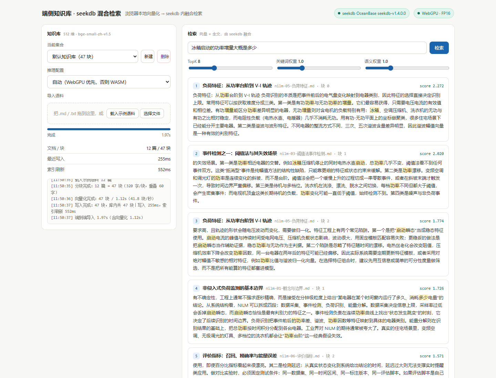

# 端侧知识库 · seekdb 混合检索

seekdb × 阶跃星辰赛题作品。一个**浏览器本地完成向量化**、用 **seekdb 做向量+全文混合检索**的迷你知识库：
导入 Markdown/文本 → 在浏览器里用 WebGPU/WASM 编码成向量 → 写入本地 seekdb → 输入问题 → 检索由数据库内核融合排序并返回原文。

- 推理位置：**浏览器**（transformers.js 3.8.1 + onnxruntime-web 1.22，跑在 Web Worker 里，不阻塞界面）
- 数据位置：**本机 seekdb 进程**（`@oceanbase/seekdb-node` 1.4.0 拉起，嵌入式部署，不需要 Docker）
- 无任何云端推理调用；没有服务端预计算，服务端连模型都不加载

```
浏览器（推理层）                       Node BFF（零推理）              seekdb（检索层）
分块 320 字/重叠 60 ─┐                /api/documents  add(向量)       t_<集合> 表
                     ├→ WebGPU FP16 ─→ /api/search     hybridSearch → VECTOR INDEX(hnsw,cosine)
Embedding 512 维 ────┘   /WASM INT8    /api/refresh                  FULLTEXT INDEX(ik)
```



启动三步：

```bash
npm install
npm run setup:model      # 下载三档精度权重，共 159MB
npm run dev              # 前端 5173 + API 8787（内含 seekdb）
```

---

## 一、模型与量化

| 项 | 值 |
| --- | --- |
| 模型 | **BAAI/bge-small-zh-v1.5**（ONNX 版，512 维，24M 参数） |
| 来源 | <https://huggingface.co/Xenova/bge-small-zh-v1.5>（base：<https://huggingface.co/BAAI/bge-small-zh-v1.5>） |
| 池化 | CLS pooling + L2 归一化（`pooling:'cls', normalize:true`） |
| 查询前缀 | v1.5 官方检索指令：`为这个句子生成表示以用于检索相关文章：`（仅查询侧，文档侧不加） |

**量化方式**：INT8 采用 onnxruntime **动态量化**（`quantize_dynamic`，`weight_type=QInt8`，逐张量、非逐通道），
FP16 采用 `convert_float_to_float16`（`keep_io_types=True`）。仓库自带的三档权重来自官方发布的同名转换版本，
`scripts/quantize.py` 提供从 fp32 复现同一配方的脚本（产出带 `_regen` 后缀，便于对照）。

| 权重 | 实测体积 | 压缩比 | 向量化吞吐（Node CPU） |
| --- | --- | --- | --- |
| FP32 基线 | 90.46 MB | 1.00× | 45.1 块/秒 |
| FP16 | 45.30 MB | **2.00×** | 27.1 块/秒 |
| INT8 | 22.80 MB | **3.97×** | 73.9 块/秒 |

> 压缩比 = 量化前体积 / 量化后体积，按 `public/models/.../onnx/` 下实际文件字节数计。

**质量变化**（语料 12 篇 → 47 块；评测集 18 条中文查询，含 6 条无字面重叠的改写问句；TopK=10）：

| 配置 | 检索路径 | Recall@5 | nDCG@10 | MRR |
| --- | --- | --- | --- | --- |
| FP32 基线 | 混合（向量+全文） | 100.0% | 95.9% | 94.4% |
| INT8 | 混合 | 100.0% | 95.9% | 94.4% |
| FP16 | 混合 | 100.0% | 95.9% | 94.4% |
| FP32 基线 | 纯向量 | 100.0% | 98.0% | 97.2% |
| INT8 | 纯向量 | 100.0% | 98.0% | 97.2% |
| FP16 | 纯向量 | 100.0% | 98.0% | 97.2% |

在 47 块的语料上三档精度的**任务指标完全一致**，说明量化没有带来可见的检索损失。为了把损失量化为可观测的数字，
另外测了两个更敏感的指标（同一批文本、同一套权重）：

| 指标 | FP32 vs INT8 | FP32 vs FP16 |
| --- | --- | --- |
| 向量平均余弦相似度 | **0.9485** | **1.0000** |
| Top-1 结果一致率 | 100% | 100% |
| Top-5 重合率（Jaccard） | 90.4% | 100% |

结论：INT8 把向量压到原来的 1/3.97，向量方向平均偏移 5%（余弦 0.9485），前五条结果的集合仍有 90% 重合，
Top-1 完全一致；FP16 在数值上无损。完整明细见 `evidence/eval-latest.json`。

---

## 二、端侧运行

- **运行时**：transformers.js 3.8.1（`@huggingface/transformers`）+ onnxruntime-web 1.22，模型与 WASM 运行时全部本地化
  （`public/models/`、`onnxruntime-web/dist/*.wasm|mjs` 走打包产物），**断网可跑**。
- **WebGPU 选择方式**：`navigator.gpu` 存在 → `requestAdapter()` 成功 → 用 `{device:'webgpu', dtype:'fp16'}` 建 pipeline；
  适配器信息（vendor/architecture）写进徽标 tooltip。
- **WASM 自动降级**：无 `navigator.gpu`、适配器为空、或 WebGPU 初始化抛异常，三种情况都回落到
  `{device:'wasm', dtype:'int8'}`，并在页头徽标显示 `WASM · INT8`，鼠标悬停可看降级原因原文。
- **界面提示**：页头常驻徽标（`WebGPU · FP16` / `WASM · INT8`），导入与检索面板的日志区逐条打印后端选择理由。
- **降级路径验证**：见 `evidence/browser-check.json` —— 无头 Chrome 实测走 WASM + INT8，
  导入 47 块与检索全流程正常，徽标与日志一致。手动验证方式：推理配置下拉选「WASM · INT8 / WASM · FP32」即可复现两条 CPU 路径。

**优化点**（都在 UI 上有实测数字，环境：Chrome 无头 + Intel gen-12lp 核显，WebGPU/FP16）

| 优化 | 做法 | 实测 |
| --- | --- | --- |
| 批处理 | 本次导入 12 篇 → 47 块，推理 batch=8，写入 batch=32 | 向量化 1.12s，吞吐 41.8 块/秒 |
| 主线程不阻塞 | 推理整体放进 Web Worker，进度用消息回传 | 加载 45MB FP16 权重期间界面不假死，进度条逐格推进 |
| 模型懒加载 + 缓存 | 首屏先可用，模型按需加载；`useBrowserCache` 复用 Cache Storage | 二次访问不重新下载（无头环境下从冷启到就绪约 3s） |
| 索引刷新策略 | 每批写完调用一次 `CALL dbms_index_manager.refresh()` | 写入 255ms、刷新 552ms，返回后才提示"已可检索" |
| 查询侧 | 单条查询只编码一次，不重复计算 | 查询向量化 24.4ms、seekdb 检索 22ms、端到端 52.4ms |

**分阶段时延（浏览器实测，47 块语料）**

| 阶段 | 首次（冷启） | 预热后（10 次中位） |
| --- | --- | --- |
| 模型下载与加载（本地文件，45.3MB FP16） | ≈ 3.0s | 命中 Cache Storage 后可忽略 |
| 文档向量化（47 块） | 1.12s（41.8 块/秒） | — |
| 写入 + 索引刷新 | 255ms + 552ms | — |
| 查询向量化 | 24.4ms | 约 25ms |
| seekdb 混合检索 | 22ms | 7ms |
| 端到端（提交查询 → 结果可展示） | 52.4ms | 35.2ms |

原始数据：`evidence/browser-bench.json`、`evidence/browser-check.json`。

---

## 三、seekdb 使用

**部署方式**：嵌入式——`@oceanbase/seekdb-node` 在应用启动时拉起一个本地 seekdb 进程（v1.4.0），
分配随机 TCP 端口，`mysql2` 走 MySQL 协议连接。不需要 Docker、不需要单独安装数据库。

> 已知限制：seekdb 原生层不接受**含中文的路径**（`errno=2`）。项目检测到路径非 ASCII 时自动降级到
> `<盘符>:\stepfun-kb-data\seekdb`，控制台打印原因；也可用 `SEEKDB_DIR` 指定。

**表结构**（一个集合一张表，检索天然隔离）：

```sql
CREATE TABLE t_kb_default (
  id VARCHAR(96) PRIMARY KEY,        -- sha1(文件名)-序号-sha1(正文前80字)，重复导入幂等
  doc_id VARCHAR(64) NOT NULL,       -- 原始文件名
  doc_title VARCHAR(255),
  seq INT,                           -- 块序号
  content TEXT,                      -- 原文
  embedding VECTOR(512),
  VECTOR INDEX vidx(embedding) WITH (distance=cosine, type=hnsw, lib=vsag),
  FULLTEXT INDEX fidx(content) WITH PARSER ik     -- 中文分词必须用 ik
) ORGANIZATION HEAP;
```

**混合检索**（融合完全在库内完成，客户端不拼合）：

```sql
SET @parm = '{"query":{"query_string":{"fields":["content"],"query":"冰箱启动功率","boost":1.0}},
              "knn":{"field":"embedding","k":8,"query_vector":[0.01,...],"boost":1.0}}';
SELECT DBMS_HYBRID_SEARCH.SEARCH('kb.t_kb_default', @parm);
```

- 全文侧 `query_string` 由数据库用 ik 分词后匹配 `content`，向量侧走 HNSW 余弦；
  两侧 `boost` 分别对应界面的「关键词权重 / 语义权重」滑块。
- 返回行自带融合分数 `_score`，前端直接展示，不做二次排序。
- 用户输入会先清洗 `+ - ( ) 引号 通配符` 等 query_string 语法字符，避免语法错误；
  万一混合检索仍报错，会自动降级为库内纯向量检索并在界面标出降级原因（不会静默糊弄）。

**增量写入与索引刷新**：

1. 写入用 `INSERT ... ON DUPLICATE KEY UPDATE`，块 ID 由内容推导 → 同一篇文档重复导入是覆盖而非追加
2. 每批写完调用 `CALL dbms_index_manager.refresh()`，返回后才向用户报告"新增 N 块，共 M 块"
3. 实测：47 块写入约 15–20ms，索引刷新约 550–650ms（刷新是导入耗时的主要来源，界面单列显示）

**集合与会话状态**：集合列表存在 `collections_meta` 表，当前选中集合记在浏览器 `localStorage`；
切换集合后检索只在对应表内进行。新建集合时一次性建好向量索引 + ik 全文索引。

---

## 四、复现与产物

```bash
npm install && npm run setup:model && npm run dev     # 启动（前端 5173，API 8787）
node server/index.mjs & npm run eval                  # 质量评测（无需浏览器）
node scripts/browser-check.mjs                        # 无头浏览器端到端自检 + 截图
```

| 路径 | 内容 |
| --- | --- |
| `src/embed-worker.ts` | 端侧推理 worker：后端探测、dtype 选择、分批编码、进度回传 |
| `src/embedder.ts` | 主线程侧的 worker 客户端（对外 API：`loadModel` / `embed`） |
| `src/chunker.ts` | 分块（320 字 / 重叠 60）、幂等块 ID、查询词高亮 |
| `server/db.mjs` | seekdb 连接、建表、写入、混合检索 SQL、索引刷新 |
| `data/corpus/` | 12 篇示例语料（NILM / 端侧推理 / seekdb 三个主题） |
| `data/eval/queries.json` | 18 条评测查询与标注 |
| `evidence/` | 评测 JSON、浏览器自检结果、截图 |
| `RUNBOOK.md` | 从零复现、常见问题、环境变量 |

不提交的内容（体积原因，脚本可重建）：`node_modules/`、`public/models/`（`npm run setup:model`）、`dist/`、数据库目录。
